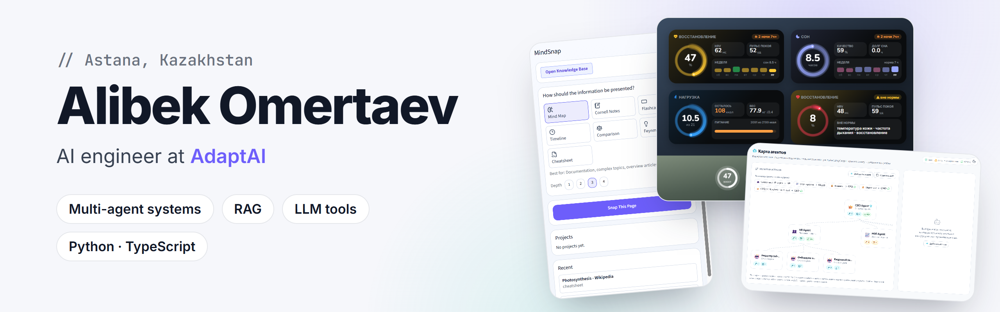
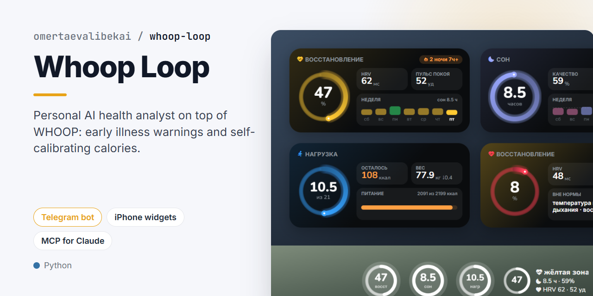
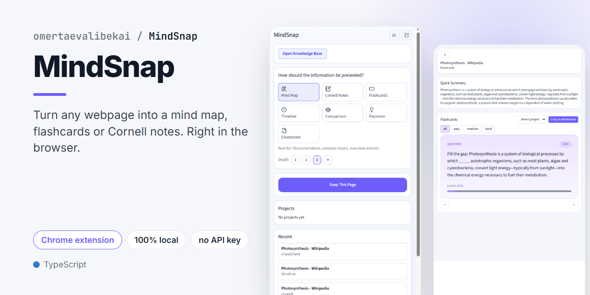
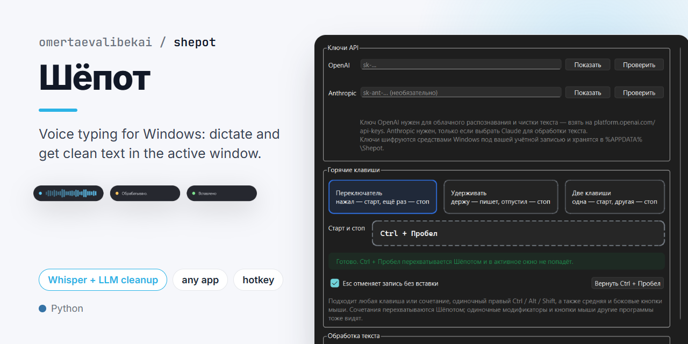
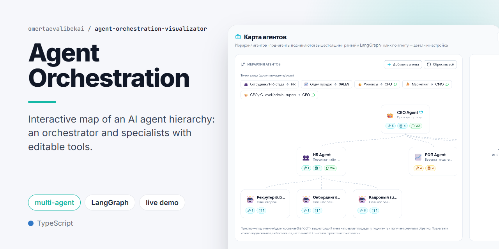
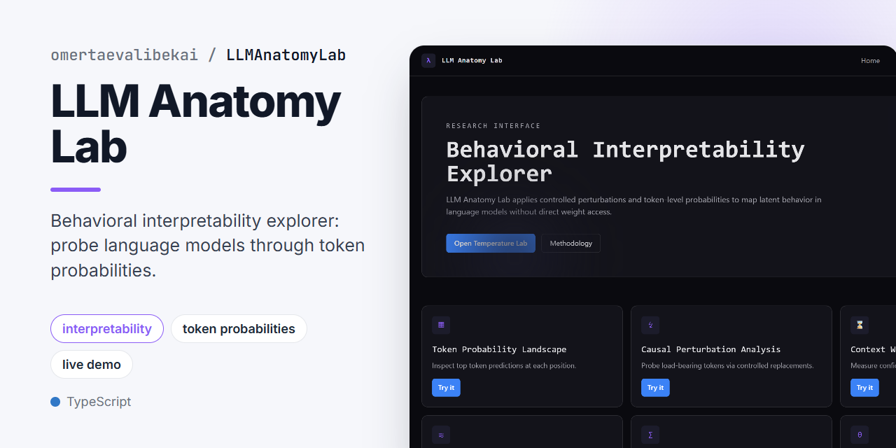
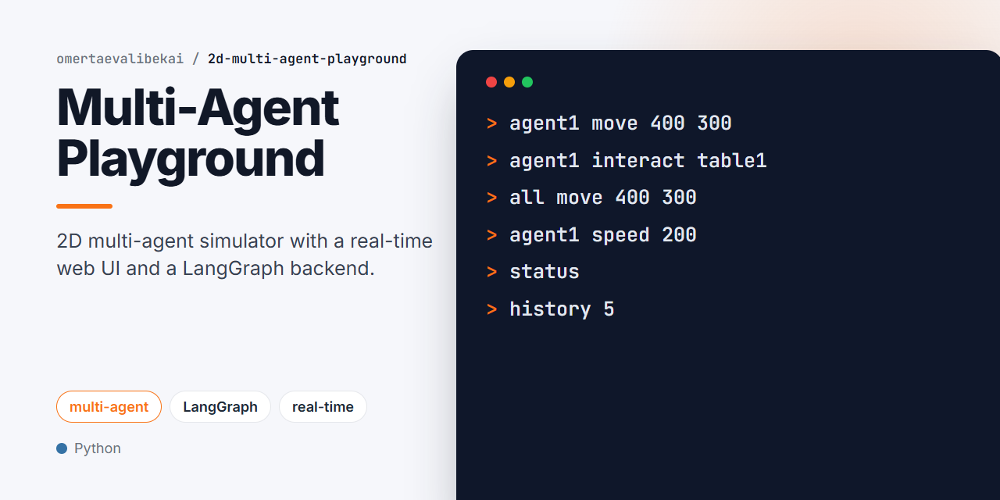

AI engineer from Astana, Kazakhstan at [AdaptAI](https://ai.fttclub.kz/). I build multi-agent systems, RAG pipelines and small tools around LLMs.

<table>
<tr>
<td width="50%" valign="top">

<b><a href="https://github.com/omertaevalibekai/whoop-loop">whoop-loop</a></b>: AI health analyst on top of WHOOP. Early illness warnings, self-calibrating calories, Telegram bot, MCP for Claude.
</td>
<td width="50%" valign="top">

<b><a href="https://github.com/omertaevalibekai/MindSnap">MindSnap</a></b>: Chrome extension that turns any webpage into a mind map, flashcards or notes. Runs locally, no API key.
</td>
</tr>
<tr>
<td width="50%" valign="top">

<b><a href="https://github.com/omertaevalibekai/shepot">shepot</a></b>: voice typing for Windows. Dictate, get clean text pasted into the active window.
</td>
<td width="50%" valign="top">

<b><a href="https://github.com/omertaevalibekai/agent-orchestration-visualizator">agent-orchestration-visualizator</a></b>: interactive map of an AI agent hierarchy with editable tools. <a href="https://agent-orchestration-visualizator.vercel.app">Demo</a>
</td>
</tr>
<tr>
<td width="50%" valign="top">

<b><a href="https://github.com/omertaevalibekai/LLMAnatomyLab">LLMAnatomyLab</a></b>: behavioral interpretability explorer for LLMs. <a href="https://llm-anatomy-lab.vercel.app">Demo</a>
</td>
<td width="50%" valign="top">

<b><a href="https://github.com/omertaevalibekai/2d-multi-agent-playground">2d-multi-agent-playground</a></b>: 2D multi-agent simulator with a real-time web UI and a LangGraph backend.
</td>
</tr>
</table>
